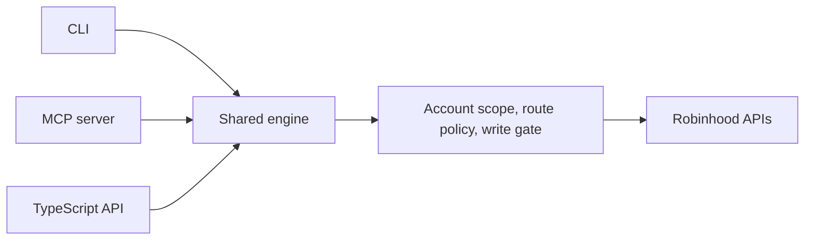

# Robinhood CLI + MCP

Manage your Robinhood accounts from a terminal or an AI assistant.

Read holdings across accounts, analyze stocks and options, review trading history, and place approved trades. The CLI and MCP server use the same account and order-handling code.

Unofficial software built around Robinhood’s web APIs. Not affiliated with Robinhood.

## What you can do

- **Portfolio:** holdings, performance, buying power, margin, and dollar-level gain/loss attribution.
- **Options:** chains, quotes, Greeks, strategy analysis, and roll planning.
- **Trading:** prepare, place, cancel, and verify stock and option orders.
- **Account services:** dividends, recurring investments, settings, documents, and supported transfer workflows.
- **MCP:** give an AI assistant access to these tools through your existing account session.

## Get started

Requires Node.js 20.19+, pnpm 10.12.1, Python 3, and Bash (Git for Windows on Windows). Sign into Robinhood in a supported browser on the same computer.

```bash
git clone https://github.com/zaydiscold/robinhood-cli-mcp-api.git
cd robinhood-cli-mcp-api
pnpm install --frozen-lockfile
pnpm build
node cli/dist/cli-entry.js accounts --json
node cli/dist/cli-entry.js portfolio --account <ACCOUNT_NUMBER>
```

Choose the account number returned by `accounts` before running an account-specific command.

The CLI attempts to reuse your signed-in browser session. Its token is stored in a local, gitignored `.env` and sent to Robinhood to authenticate requests. If session recovery fails, sign in through the browser and run `pnpm auth:refresh`.

## Common commands

```bash
node cli/dist/cli-entry.js positions
node cli/dist/cli-entry.js options positions
node cli/dist/cli-entry.js performance --span ytd
node cli/dist/cli-entry.js margin
node cli/dist/cli-entry.js history --days 30
```

Use `--help` for command options and `--json` for structured output. The [command reference](docs/command-reference.md) covers the full workflows.

## Connect an AI assistant

After building, register the MCP server with your client. For Claude Code:

```bash
claude mcp add robinhood-cli -s user -- \
  node /absolute/path/to/robinhood-cli-mcp-api/mcp/dist/server.js
```

Then ask it to explain your portfolio changes, inspect option exposure, review trades, or prepare a trade plan. For clients configured through JSON:

```json
{
  "mcpServers": {
    "robinhood-cli": {
      "command": "node",
      "args": ["/absolute/path/to/robinhood-cli-mcp-api/mcp/dist/server.js"]
    }
  }
}
```

Use an absolute path. Keep credentials out of client configuration; see the authentication guide for a shared `ROBINHOOD_ENV_PATH`.

Other MCP clients use the same server command. Agents start with [SKILL.md](SKILL.md); client setup and tool profiles are in the [MCP guide](mcp/README.md).

## Trading behavior

Account changes default to a preview. Sending a live order or account change requires the write setting and your approval for that action. The tool verifies results through broker history. Reads may recover an expired session and retry once; account-changing requests are not automatically replayed.

Options, margin, and transfers use real money. Review the account, amount, price, and order details before approving. See the [operating contract](docs/write-operations.md) for the exact behavior.

## Preview an order

After selecting your account, this example builds a preview and sends no order:

```bash
node cli/dist/cli-entry.js buy --symbol AAPL --shares 1 --price 100 \
  --account <ACCOUNT_NUMBER> --tif gfd --dry-run --json
```

The price is illustrative. An explicit `--dry-run` keeps the request a preview even in a process configured for live writes.

## Architecture



## Documentation

- [Command reference](docs/command-reference.md) — commands by task.
- [Authentication](docs/auth.md) — supported browsers and session recovery.
- [Financial calculations](docs/financial-tools-reference.md) — what the reported numbers mean.
- [Documentation index](docs/README.md) — detailed guides and historical research.
- [Contributing](CONTRIBUTING.md) — development and maintenance.

See [SECURITY.md](SECURITY.md) for private vulnerability reporting and [ROADMAP.md](ROADMAP.md) for planned work.

Personal trading notes and encrypted operator files are optional; they are not required to install or use the public code. This software does not provide investment, tax, or legal advice.

MIT © Zayd Khan
